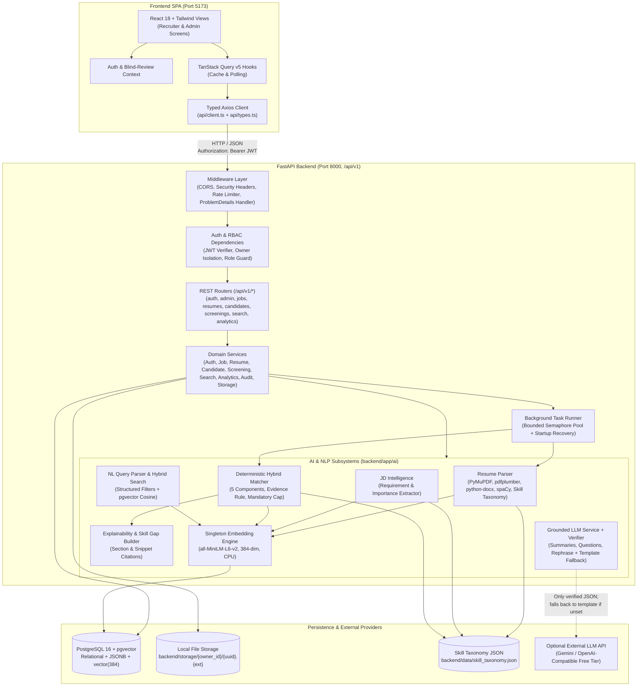
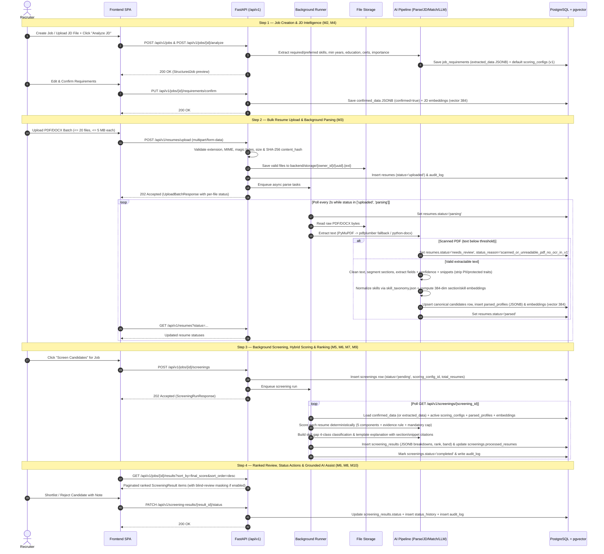
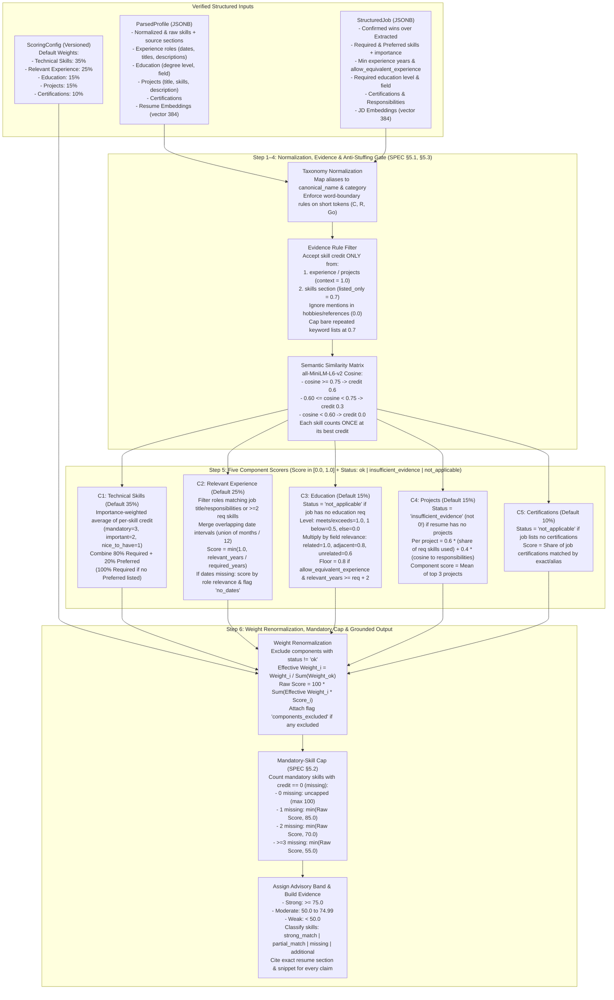

# System Architecture, Data Model, and AI Pipelines (`docs/Flow.md`)

This document tracks the architecture, end-to-end data flows, hybrid AI matching pipeline, relational + `JSONB` + `pgvector` entity-relationship model, repository layout, and phase-by-phase flow log per `.agent/rules/project-rules.md`.

---

## 1. Architecture (`System Architecture`)

The system is a three-tier containerized stack orchestrated via Docker Compose:
1. **Frontend SPA (`React 18 + TypeScript + Vite`, port `5173`)** communicating exclusively with `/api/v1` via typed Axios calls and TanStack Query hooks.
2. **Backend API & AI Engine (`FastAPI + SQLAlchemy 2 + CPU NLP/Embeddings`, port `8000`)** enforcing JWT RBAC, tenant isolation, deterministic hybrid scoring, and grounded LLM generation with template fallback.
3. **Storage Layer (`PostgreSQL 16 + pgvector` + local content-addressed file storage `backend/storage/`)**.



---

## 2. End-to-End Data Flow: Upload $\rightarrow$ Parse $\rightarrow$ Screen $\rightarrow$ Rank

The sequence below traces how a recruiter creates/confirms a job, uploads a batch of resumes, parses them asynchronously into structured profiles and embeddings, runs a versioned background screening, and reviews ranked candidates with evidence-backed explanations.



---

## 3. AI Pipeline (`Hybrid Matching Pipeline`)

The M5 matching engine (`backend/app/ai/matching/`) is a **pure, deterministic function** `score_resume_against_job(parsed_profile, structured_job, scoring_config, embeddings) -> ScreeningResultPayload`. It never calls an LLM and never reads candidate names, emails, or protected characteristics.



---

## 4. Data Model (`Database ERD`)

All **13 tables** required by the specification and Phase 0 prompt are modeled below:
`users`, `jobs`, `job_requirements`, `resumes`, `candidates`, `parsed_profiles`, `screenings`, `screening_results`, `status_history`, `feedback` (**`planned, not created`** — Alembic migration deferred to Phase 12 per `D-013`), `scoring_configs`, `embeddings`, and `audit_log`. Every `JSONB` column is explicitly marked with `JSONB`.

```mermaid
erDiagram
    users ||--o{ jobs : "owns (owner_id)"
    users ||--o{ resumes : "uploads (owner_id)"
    users ||--o{ candidates : "owns (owner_id)"
    users ||--o{ screenings : "triggers (triggered_by)"
    users ||--o{ scoring_configs : "creates (created_by)"
    users ||--o{ status_history : "records (changed_by)"
    users ||--o{ feedback : "submits (recruiter_id) [planned, not created - Phase 12]"
    users ||--o{ audit_log : "acts (actor_id)"

    jobs ||--|| job_requirements : "has structured (job_id)"
    jobs ||--o{ scoring_configs : "versions weights (job_id)"
    jobs ||--o{ screenings : "runs (job_id)"
    jobs ||--o{ screening_results : "ranks (job_id)"

    candidates ||--o{ resumes : "has versions (candidate_id)"
    candidates ||--o{ screening_results : "evaluated in (candidate_id)"

    resumes ||--|| parsed_profiles : "parsed into (resume_id)"
    resumes ||--o{ screening_results : "scored in (resume_id)"

    scoring_configs ||--o{ screenings : "used by (scoring_config_id)"
    scoring_configs ||--o{ screening_results : "pinned in (scoring_config_id)"

    screenings ||--o{ screening_results : "produces (screening_id)"

    screening_results ||--o{ status_history : "tracks (screening_result_id)"
    screening_results ||--o{ feedback : "receives (screening_result_id) [planned, not created - Phase 12]"

    users ||--o{ embeddings : "scopes (owner_id)"

    users {
        UUID id PK
        VARCHAR email UK "Indexed, lowercase"
        VARCHAR password_hash "Argon2 / bcrypt"
        VARCHAR full_name
        VARCHAR role "recruiter | admin"
        BOOLEAN is_active "Default true"
        TIMESTAMPTZ last_login_at "Nullable"
        TIMESTAMPTZ created_at
        TIMESTAMPTZ updated_at
    }

    jobs {
        UUID id PK
        UUID owner_id FK "References users(id) ON DELETE CASCADE"
        VARCHAR title
        VARCHAR department "Nullable"
        TEXT description
        JSONB required_skills "JSONB: array of skill strings"
        JSONB preferred_skills "JSONB: array of skill strings"
        FLOAT min_years_experience "Default 0"
        VARCHAR required_education_level "Nullable (high_school|associate|bachelor|master|phd|none)"
        VARCHAR required_education_field "Nullable"
        BOOLEAN allow_equivalent_experience "Default false"
        JSONB certifications "JSONB: array of strings"
        JSONB responsibilities "JSONB: array of strings"
        VARCHAR employment_type "full_time | part_time | contract | internship"
        VARCHAR status "draft | open | closed | archived"
        VARCHAR source_filename "Nullable"
        TIMESTAMPTZ created_at
        TIMESTAMPTZ updated_at
    }

    job_requirements {
        UUID id PK
        UUID job_id FK,UK "References jobs(id) ON DELETE CASCADE"
        JSONB extracted_data "JSONB: StructuredJob extracted by M4"
        JSONB confirmed_data "JSONB: StructuredJob confirmed/edited by recruiter"
        BOOLEAN is_confirmed "Default false"
        TIMESTAMPTZ analyzed_at
        TIMESTAMPTZ confirmed_at "Nullable"
        TIMESTAMPTZ updated_at
    }

    scoring_configs {
        UUID id PK
        UUID job_id FK "References jobs(id) ON DELETE CASCADE"
        INTEGER version "Monotonic per job: 1, 2, 3..."
        JSONB weights "JSONB: {technical_skills, relevant_experience, education, projects, certifications}"
        JSONB mandatory_cap_rules "JSONB: {one_missing: 85, two_missing: 70, three_plus_missing: 55}"
        BOOLEAN is_active "True for latest version on job"
        UUID created_by FK "References users(id) ON DELETE SET NULL"
        TIMESTAMPTZ created_at
    }

    candidates {
        UUID id PK
        UUID owner_id FK "References users(id) ON DELETE CASCADE"
        VARCHAR blind_code "Deterministic anonymized label e.g. CAND-8F2A"
        VARCHAR display_name "Nullable (never used in scoring)"
        VARCHAR primary_email "Nullable, indexed per owner_id"
        VARCHAR primary_phone "Nullable"
        VARCHAR location "Nullable"
        VARCHAR headline "Nullable"
        UUID latest_resume_id "Nullable UUID of newest parsed resume"
        TIMESTAMPTZ created_at
        TIMESTAMPTZ updated_at
    }

    resumes {
        UUID id PK
        UUID owner_id FK "References users(id) ON DELETE CASCADE"
        UUID candidate_id FK "Nullable, references candidates(id) ON DELETE SET NULL"
        VARCHAR original_filename
        VARCHAR storage_path "backend/storage/{owner_id}/{uuid}.{ext}"
        VARCHAR mime_type "application/pdf | application/vnd.openxmlformats..."
        INTEGER file_size_bytes
        VARCHAR content_hash "SHA-256 hex digest (indexed with owner_id)"
        VARCHAR status "uploaded | parsing | parsed | needs_review | failed"
        VARCHAR status_reason "Nullable error or review code"
        INTEGER parse_attempts "Default 0"
        TIMESTAMPTZ uploaded_at
        TIMESTAMPTZ parsed_at "Nullable"
        TIMESTAMPTZ updated_at
    }

    parsed_profiles {
        UUID id PK
        UUID resume_id FK,UK "References resumes(id) ON DELETE CASCADE"
        UUID candidate_id FK "References candidates(id) ON DELETE CASCADE"
        TEXT raw_text "Cleaned full text (never logged)"
        JSONB section_map "JSONB: segmented raw text by section name"
        JSONB contact_info "JSONB: {name, email, phone, location} with confidence & source_section"
        JSONB summary "JSONB: {text, source_section, confidence, null_reason}"
        JSONB skills "JSONB: normalized & raw skills with category, context_type, snippet, confidence"
        JSONB experience "JSONB: roles array with company, title, start, end, months, skills, snippet, confidence"
        JSONB education "JSONB: entries array with degree_level, field, institution, grad_year, snippet, confidence"
        JSONB certifications "JSONB: entries array with name, canonical_name, issuer, year, snippet, confidence"
        JSONB projects "JSONB: entries array with title, description, skills, snippet, confidence"
        JSONB achievements "JSONB: entries array with text, source_section, snippet, confidence"
        FLOAT total_experience_years "Nullable computed union of role intervals"
        JSONB extraction_flags "JSONB: array of flags (low_text_quality, no_dates, prompt_injection_suspected, etc.)"
        VARCHAR parser_version "e.g. v1.0.0"
        TIMESTAMPTZ created_at
        TIMESTAMPTZ updated_at
    }

    screenings {
        UUID id PK
        UUID job_id FK "References jobs(id) ON DELETE CASCADE"
        UUID scoring_config_id FK "References scoring_configs(id) ON DELETE RESTRICT"
        INTEGER config_version "Snapshot of scoring_configs.version"
        UUID triggered_by FK "References users(id) ON DELETE SET NULL"
        VARCHAR status "pending | running | completed | failed"
        INTEGER total_resumes
        INTEGER processed_resumes "Default 0"
        INTEGER failed_resumes "Default 0"
        JSONB summary_stats "JSONB: {avg_score, strong_count, moderate_count, weak_count}"
        TEXT error_message "Nullable"
        TIMESTAMPTZ started_at
        TIMESTAMPTZ completed_at "Nullable"
    }

    screening_results {
        UUID id PK
        UUID screening_id FK "References screenings(id) ON DELETE CASCADE"
        UUID job_id FK "References jobs(id) ON DELETE CASCADE"
        UUID resume_id FK "References resumes(id) ON DELETE CASCADE"
        UUID candidate_id FK "References candidates(id) ON DELETE CASCADE"
        UUID scoring_config_id FK "References scoring_configs(id) ON DELETE RESTRICT"
        INTEGER config_version
        FLOAT final_score "0.0 to 100.0"
        VARCHAR band "strong | moderate | weak"
        INTEGER rank_position "1-based rank within screening_id"
        VARCHAR review_status "new | shortlisted | rejected | on_hold"
        JSONB component_scores "JSONB: 5 components with score, status, original_weight, effective_weight, details"
        JSONB skill_analysis "JSONB: {strong_match, partial_match, missing, additional} with evidence snippets"
        JSONB evidence "JSONB: array of {claim, section, snippet, score_impact}"
        JSONB explanation "JSONB: {strengths, gaps, breakdown_text, is_llm_rephrased}"
        JSONB summary_data "JSONB: Nullable M8 summary payload + recommendation + is_template_fallback"
        JSONB interview_questions "JSONB: Nullable M10 questions array + is_template_fallback"
        JSONB flags "JSONB: array of flags (mandatory_cap_applied, components_excluded, no_dates, etc.)"
        TIMESTAMPTZ created_at
        TIMESTAMPTZ updated_at
    }

    status_history {
        UUID id PK
        UUID screening_result_id FK "References screening_results(id) ON DELETE CASCADE"
        VARCHAR old_status "new | shortlisted | rejected | on_hold"
        VARCHAR new_status "new | shortlisted | rejected | on_hold"
        TEXT note "Nullable recruiter note"
        UUID changed_by FK "References users(id) ON DELETE SET NULL"
        TIMESTAMPTZ changed_at
    }

    embeddings {
        UUID id PK
        UUID owner_id FK "References users(id) ON DELETE CASCADE"
        VARCHAR entity_type "resume | job | skill_taxonomy"
        UUID entity_id "References resumes(id) or jobs(id)"
        VARCHAR chunk_type "full_summary | skills | experience | project | responsibilities"
        INTEGER chunk_index "Default 0"
        TEXT chunk_text "Source text snippet"
        VECTOR_384 embedding "pgvector vector(384) with HNSW cosine index"
        VARCHAR model_name "all-MiniLM-L6-v2"
        VARCHAR model_version "1.0"
        TIMESTAMPTZ created_at
    }

    audit_log {
        UUID id PK
        UUID actor_id FK "Nullable, references users(id) ON DELETE SET NULL"
        VARCHAR actor_role "recruiter | admin | system"
        VARCHAR action "e.g. user.login_succeeded, resume.deleted, result.status_changed"
        VARCHAR target_type "user | job | resume | candidate | screening | screening_result | config"
        UUID target_id "Nullable UUID of target entity"
        JSONB details "JSONB: PII-free structured metadata (counts, old/new status, config_version)"
        VARCHAR ip_address "Nullable"
        TIMESTAMPTZ created_at
    }

    feedback {
        UUID id PK "PLANNED, NOT CREATED until Phase 12 (D-013)"
        UUID screening_result_id FK "References screening_results(id) ON DELETE CASCADE"
        UUID recruiter_id FK "References users(id) ON DELETE CASCADE"
        INTEGER rating "1 to 5 scale"
        BOOLEAN agrees_with_band
        VARCHAR suggested_band "Nullable: strong | moderate | weak"
        TEXT comment "Nullable"
        JSONB details "JSONB: optional per-component feedback tags (planned, not created - Phase 12)"
        TIMESTAMPTZ created_at
    }
```



---

## 5. Final Repository Folder Tree

Below is the complete target repository structure derived from `REPO LAYOUT` in `.agent/rules/project-rules.md`. No top-level folders have been renamed or moved (`D-012`), and no folders outside `/docs` are created during Phase 0.

```text
AI-Resume-Screening/
├── .agent/
│   └── rules/
│       └── project-rules.md
├── docs/
│   ├── SPEC.md
│   ├── api-contract.md
│   ├── Decisions.md
│   ├── Flow.md
│   ├── PROGRESS.md
│   ├── EVAL_PARSING.md              # Created in Phase 3
│   ├── EVAL_JD.md                   # Created in Phase 4
│   ├── EVAL_MATCHING.md             # Created in Phase 5
│   ├── EVAL_GROUNDING.md            # Created in Phase 7
│   ├── EVAL_SEARCH.md               # Created in Phase 8
│   ├── EVALUATION.md                # Consolidated evaluation & bias audit (Phase 10/11, D-012)
│   ├── VECTOR_DECISION.md           # Created in Phase 8
│   └── DEPLOYMENT.md                # Created in Phase 11
├── backend/
│   ├── app/
│   │   ├── __init__.py
│   │   ├── main.py
│   │   ├── api/
│   │   │   ├── __init__.py
│   │   │   ├── deps.py              # JWT auth, role guard, owner isolation dependencies
│   │   │   ├── problem_details.py   # RFC 7807 exception handlers & responses
│   │   │   └── v1/
│   │   │       ├── __init__.py
│   │   │       ├── router.py
│   │   │       ├── health.py
│   │   │       ├── auth.py
│   │   │       ├── admin.py
│   │   │       ├── jobs.py
│   │   │       ├── resumes.py
│   │   │       ├── candidates.py
│   │   │       ├── screenings.py
│   │   │       ├── search.py
│   │   │       ├── analytics.py
│   │   │       └── feedback.py      # Planned, not created until Phase 12 (D-013)
│   │   ├── core/
│   │   │   ├── __init__.py
│   │   │   ├── config.py            # pydantic-settings configuration
│   │   │   ├── database.py          # SQLAlchemy 2 engine & session factory
│   │   │   ├── security.py          # Argon2/bcrypt hashing, JWT encode/decode
│   │   │   ├── rate_limit.py        # Sliding-window rate limiter
│   │   │   └── logging.py           # PII-redacting structured logger
│   │   ├── models/
│   │   │   ├── __init__.py
│   │   │   ├── user.py
│   │   │   ├── job.py               # Job, JobRequirements, ScoringConfig
│   │   │   ├── candidate.py         # Candidate
│   │   │   ├── resume.py            # Resume, ParsedProfile
│   │   │   ├── screening.py         # Screening, ScreeningResult, StatusHistory
│   │   │   ├── embedding.py         # Embedding (pgvector)
│   │   │   ├── audit_log.py         # AuditLog
│   │   │   └── feedback.py          # Planned, not created until Phase 12 (D-013)
│   │   ├── schemas/
│   │   │   ├── __init__.py
│   │   │   ├── common.py            # ProblemDetails, PaginatedResponse, enums
│   │   │   ├── auth.py
│   │   │   ├── admin.py
│   │   │   ├── job.py
│   │   │   ├── resume.py
│   │   │   ├── candidate.py
│   │   │   ├── screening.py
│   │   │   ├── search.py
│   │   │   ├── analytics.py
│   │   │   └── feedback.py          # Planned, not created until Phase 12 (D-013)
│   │   ├── services/
│   │   │   ├── __init__.py
│   │   │   ├── auth_service.py
│   │   │   ├── admin_service.py
│   │   │   ├── job_service.py
│   │   │   ├── resume_service.py
│   │   │   ├── candidate_service.py
│   │   │   ├── screening_service.py
│   │   │   ├── search_service.py
│   │   │   ├── analytics_service.py
│   │   │   ├── storage_service.py   # Abstract + local disk implementation
│   │   │   ├── audit_service.py
│   │   │   └── feedback_service.py  # Planned, not created until Phase 12 (D-013)
│   │   └── ai/
│   │       ├── __init__.py
│   │       ├── model_registry.py    # Lazy CPU singleton for MiniLM & spaCy
│   │       ├── taxonomy.py          # Skill normalization & alias lookup
│   │       ├── parsing/
│   │       │   ├── __init__.py
│   │       │   ├── text_extractor.py
│   │       │   ├── section_splitter.py
│   │       │   ├── field_extractor.py
│   │       │   └── pii_redactor.py
│   │       ├── jd/
│   │       │   ├── __init__.py
│   │       │   └── analyzer.py
│   │       ├── matching/
│   │       │   ├── __init__.py
│   │       │   ├── scorer.py        # Pure deterministic 5-component engine
│   │       │   ├── components.py
│   │       │   └── intervals.py     # Union of experience date ranges
│   │       ├── explain/
│   │       │   ├── __init__.py
│   │       │   ├── explainer.py
│   │       │   └── skill_gaps.py
│   │       ├── llm/
│   │       │   ├── __init__.py
│   │       │   ├── client.py        # Provider-agnostic client + template fallback
│   │       │   ├── grounding.py     # Post-generation fact/entity verifier
│   │       │   ├── summary_gen.py
│   │       │   └── question_gen.py
│   │       └── search/
│   │           ├── __init__.py
│   │           ├── query_parser.py  # NL query -> structured filters + semantic query
│   │           └── ranker.py
│   ├── alembic/
│   │   ├── env.py
│   │   └── versions/
│   ├── tests/
│   │   ├── conftest.py
│   │   ├── unit/
│   │   ├── integration/
│   │   └── security/
│   ├── data/
│   │   ├── skill_taxonomy.json      # ~150 canonical skills, aliases, categories
│   │   └── synthetic/               # Synthetic resumes, JDs & gold evaluation labels
│   ├── storage/                     # Git-ignored local resume file storage
│   ├── .venv/                       # Git-ignored Python virtual environment
│   ├── requirements.txt
│   ├── Dockerfile
│   └── .env.example
├── frontend/
│   ├── src/
│   │   ├── main.tsx
│   │   ├── App.tsx
│   │   ├── api/
│   │   │   ├── types.ts             # Copied verbatim from docs/api-contract.md
│   │   │   └── client.ts            # Typed Axios functions + ProblemDetails parser
│   │   ├── hooks/
│   │   │   ├── useAuth.ts
│   │   │   ├── useJobs.ts
│   │   │   ├── useResumes.ts
│   │   │   ├── useCandidates.ts
│   │   │   ├── useScreenings.ts
│   │   │   ├── useSearch.ts
│   │   │   ├── useAnalytics.ts
│   │   │   └── useAdmin.ts
│   │   ├── pages/
│   │   │   ├── LoginPage.tsx
│   │   │   ├── RegisterPage.tsx
│   │   │   ├── JobsListPage.tsx
│   │   │   ├── JobDetailPage.tsx
│   │   │   ├── JobRequirementsPage.tsx
│   │   │   ├── ResumesPage.tsx
│   │   │   ├── ResumeProfilePage.tsx
│   │   │   ├── ScreeningResultsPage.tsx
│   │   │   ├── CandidateResultDetailPage.tsx
│   │   │   ├── CandidateComparePage.tsx
│   │   │   ├── SearchPage.tsx
│   │   │   ├── AnalyticsPage.tsx
│   │   │   ├── AdminUsersPage.tsx
│   │   │   ├── AdminAuditLogPage.tsx
│   │   │   └── NotFoundPage.tsx
│   │   ├── components/
│   │   │   ├── layout/
│   │   │   ├── common/              # Skeleton, EmptyState, ErrorBanner, Pagination, Modal
│   │   │   ├── jobs/
│   │   │   ├── resumes/
│   │   │   ├── screening/
│   │   │   ├── search/
│   │   │   └── analytics/
│   │   └── context/
│   │       ├── AuthContext.tsx
│   │       └── BlindReviewContext.tsx
│   ├── public/
│   ├── package.json
│   ├── vite.config.ts
│   └── .env.example
├── scripts/
│   ├── seed_admin.py                # Creates initial Admin from env vars
│   ├── generate_synthetic_data.py   # Builds synthetic test corpus (resumes + JDs)
│   ├── eval_parsing.py
│   ├── eval_jd.py
│   ├── eval_matching.py             # CLI entry point for M5 matching engine in Phase 5
│   ├── eval_grounding.py
│   ├── eval_search.py
│   ├── bias_audit.py                # Counterfactual fairness test suite
│   └── smoke_test.py                # End-to-end deployment smoke test
├── docker-compose.yml
├── README.md
└── .gitignore
```

---

## 6. Phase Flow Log

### Phase 0: Planning, Architecture, ERD, and API Contract (2026-11-13)
- **What flows where:** No runtime code is executed in Phase 0. Product requirements from `docs/SPEC.md` and engineering constraints from `.agent/rules/project-rules.md` flow into the four foundational project record documents:
  1. `docs/Decisions.md` locks `D-001`–`D-013` (including `D-013` deferring the `feedback` Alembic migration to Phase 12), classifies every feature (`MVP` vs `POSTPONED` vs `NON-GOAL`), and documents 12 critical risks and mitigations.
  2. `docs/Flow.md` establishes the 3-tier architecture, end-to-end sequence flow, 5-component deterministic matching pipeline, 13-table relational/`JSONB`/`pgvector` ERD (with `feedback` marked `planned, not created` until Phase 12), and target repository tree.
  3. `docs/api-contract.md` defines the `/api/v1` REST handshake, RFC 7807 `ProblemDetails` format, all 53 endpoints (`E-01`–`E-53`) across M1–M12 (with `E-29` in Phase 6 / 6.5 since Phase 5 is service + CLI only, and `E-41` in Phase 7 / 7.5 when LLM support arrives), and the exact TypeScript types for `frontend/src/api/types.ts`.
  4. `docs/PROGRESS.md` sets the 20-phase delivery roadmap (`0` through `12`) and records Phase 0 verification evidence.

